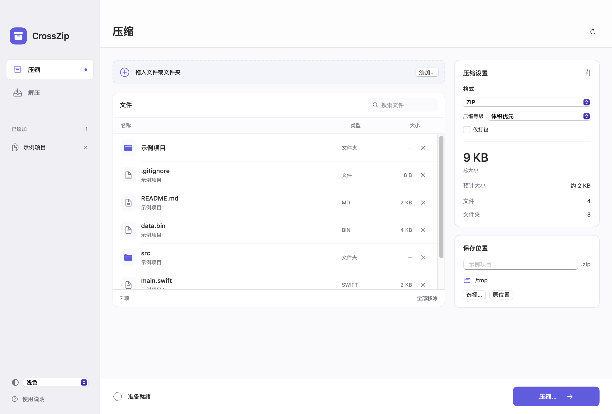

# CrossZip

中文界面的 macOS 压缩与解压工具。拖入文件、文件夹或压缩包，所有处理均在本机完成。

**支持 Apple 芯片 Mac，macOS 14 或更新版本。当前公开预览版：1.5.2。**



## 下载与安装

在本仓库的 **Releases** 页面下载 `CrossZip-1.5.2-macos-arm64.dmg`，打开后将
`CrossZip.app` 拖到“应用程序”。也可下载同名 ZIP，解压后移动应用。
日常使用无需 Python、Homebrew 或终端。

发布包采用 **ad-hoc 本地签名，尚未经过 Apple 公证**。浏览器下载后，macOS 可能阻止首次打开。
仅在确认下载来源并核对发布页的 SHA-256 后，按
[Apple 的打开说明](https://support.apple.com/zh-cn/102445)，到“系统设置 → 隐私与安全性”允许打开这个应用。
无需关闭 Gatekeeper。当前不提供 Intel、Windows 或 Linux 版本。

## 使用

- **压缩**：拖入或选择多个文件、文件夹。右侧选择格式、压缩等级、名称和保存位置；未指定位置时，
  默认保存到第一个所选项目的所在目录。已有同名包时自动编号。
- **解压**：拖入一个压缩包，检查预览和文件名后，解压全部或勾选的内容；结果放入新建的同名目录，
  已有目录自动编号，避免覆盖。
- **移除选择**：文件行的 × 和“全部移除”只改变本次任务，不删除磁盘原文件；移除的内容可重新添加。
- **Finder 右键**：安装并首次打开后，选中文件，使用“服务 → 使用 CrossZip 压缩”。
  若未显示，可在“系统设置 → 键盘 → 键盘快捷键 → 服务”启用。系统自带“压缩”继续保留。
- **外观**：左下角选择“跟随系统 / 浅色 / 深色”，默认跟随系统。

多选独立项目时，会增加以压缩包名称命名的外层目录；单选文件夹保留其自身目录。
不同位置的输入保留共同父目录下的相对路径，避免同名文件互相覆盖。
完成后可在 Finder 中显示结果，处理时支持取消。

## 格式

| 格式 | 创建 | 解压 |
| --- | --- | --- |
| ZIP / ZIP64（Stored、Deflate） | ✓ | ✓ |
| 7z（创建使用 LZMA2） | ✓ | ✓ |
| TAR、TAR.GZ、TAR.BZ2、TAR.XZ | ✓ | ✓ |
| RAR / RAR5、CAB、CPIO、ISO、AR | — | ✓ |
| GZ、BZ2、XZ、LZMA、LZIP、Unix compress 单文件流 | — | ✓ |

暂不支持加密包、分卷包、ZIP 的其他压缩方法和多重压缩数据流；不提供批量任务队列。
单独 `.gz` 等后缀解开一层，`.tar.gz` / `.tgz` 等组合后缀展开 TAR 目录。
旧 ZIP 名称乱码时，可手动选择 UTF-8、GB18030 / GBK 或 CP437 后重新预览。

## 文件保留与 Windows 互通

- 保留原始文件名、目录结构、空目录和文件字节，不转换文字编码、换行符、图片或文档。
  输入中已有的隐藏文件、`.DS_Store`、`._` 和 `__MACOSX` 都会保留；不额外生成 Mac 元数据附带文件。
- Windows 非法名称、保留名称、长路径、大小写或 Unicode 差异会提示，仍允许原样打包。
  **Windows 本身无法保存的名称，不能保证用其自带解压工具还原。** 软件不会擅自改名。
- 符号链接保存链接本身及原始目标，不跟随链接打包外部内容；解压先写普通文件，最后创建链接。
  Windows 自带工具可能无法还原符号链接。TAR 硬链接还原为内容相同的普通文件。
- 输出先写入目标旁的私有临时目录，校验成功后才发布；正常取消或失败清理临时内容。
  强制结束进程或断电可能留下 `.crosszip-*` 临时目录。
- 压缩后重读全部条目并比较名称、类型、大小与 SHA-256；ZIP 另核对 CRC。
  解压拒绝越界路径、重复条目和结构冲突，并核验实际写出内容。源文件变化、权限或空间不足会终止。
- 裸 TAR 等格式没有内容校验码，无法仅凭外来归档判断内容是否曾被修改；重要交换应附原始 SHA-256 清单。
- 用于普通文件交换，不用于保留 Finder 标签、资源叉、扩展属性和完整系统权限的系统备份。

**Windows 10 / 11 资源管理器的完整双向实机验收仍待完成。**
自动化 Windows PowerShell 解压与 SHA-256 检查已配置到 CI，远程结果以 Actions 实际运行记录为准；
它不替代资源管理器的手工验收。最低部署目标 macOS 14 也仍待该系统实机验证。

## 压缩率与大小估算

默认“体积优先”实际比较 9、6、1 三个等级，保留其中更小的有效结果，处理时间和临时空间需求相应增加。
“快速”固定 1，“标准”固定 6；TAR 仅打包，ZIP 可选“只打包”。这些选项均不改变文件内容。
此策略保证不大于同次输入的这三个候选结果，不表示达到某种格式的理论最佳压缩率。

小选择（普通文件合计不超过 8 MiB、总条目不超过 256）完整试压；大选择最多抽取 24 个文件、
累计 8 MiB 进行粗估，并显示实际抽样量。选样偏向较大文件，误差尚未标定，**粗估数值不保证最终大小**。

## 从源码构建

需要 Apple 芯片 Mac、macOS 14+、Xcode 或包含 Swift 5.9+ 的命令行工具，以及 Python 3.9+（仅测试需要）。
下载源码后，在项目目录执行：

```sh
bash scripts/build_app.sh
```

输出为 `dist/CrossZip.app` 和 `dist/crosszip-cli`。
首次构建会校验并编译随源码附带的 libarchive 3.8.11 / liblzma 5.8.4；
SwiftPM 获取固定版本 ZIPFoundation 0.9.20，仅用于独立测试夹具，不链接到应用。
生成的 `Vendor/Native/`、`.build/` 和 `dist/` 不提交到仓库。

```sh
bash scripts/check.sh                 # 构建、常规测试、独立工具交叉验证
CROSSZIP_LARGE_TESTS=1 bash scripts/check.sh  # 另含 >4 GiB 与 65,536 条目 ZIP64
bash scripts/package_release.sh       # 生成 DMG、ZIP 和 SHA256SUMS
bash scripts/install_finder_service.sh # 安装到个人应用程序目录并注册服务
```

详见 [测试说明](TESTING.md)、[审查记录](AUDIT.md)、[更新记录](CHANGELOG.md)。

## 开源许可

项目代码采用 [MIT License](LICENSE)。原样包含的第三方源码和测试夹具遵循各自许可证，见
[第三方声明](THIRD_PARTY_NOTICES.md) 和 [依赖说明](Vendor/README.md)。

## English

CrossZip is a local, native macOS archive utility with a Chinese UI. Requires Apple Silicon and macOS 14+.
Create ZIP/ZIP64, 7z and TAR variants; extract these plus RAR and other supported formats.
File bytes and names are preserved; Windows-incompatible names produce warnings without automatic renaming.
Download an app bundle from Releases, or run `bash scripts/build_app.sh` from the source directory.
Downloads are ad-hoc signed and **not Apple-notarized**. Full Windows Explorer interoperability remains pending validation.
